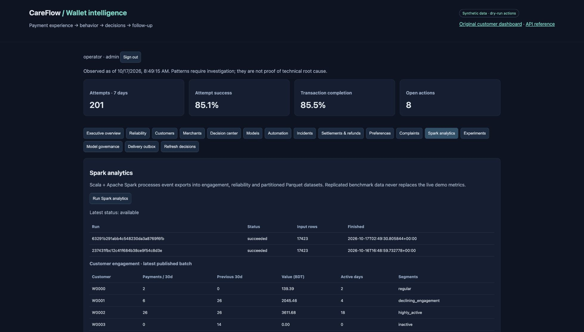

# CareFlow

**Payment reliability and customer retention analytics for a digital wallet.**

A customer stops using a wallet after several failed payments. Sending them a promotional message probably isn't the right next step. Someone needs to look at the payment problem first.

That's the idea behind CareFlow. It brings payment history, customer activity and merchant performance into one dashboard, then suggests what a support or operations team should do next. An unresolved payment or complaint takes priority over a retention offer.

This is a portfolio project built with synthetic data. It runs locally and in Docker. Messages are simulated by default, and refund and settlement records don't move real money.



## What it does

The system follows a payment from its incoming events through to a possible follow-up action:

1. **Keep the payment history straight.** Duplicate events are checked, retries are counted separately from transactions, and a timeout can later be reconciled with a successful payment.
2. **Look for changes in activity.** Customer views include recency, frequency, spending, preferred categories and usual payment cadence. Merchant views compare recent performance with their own history and similar merchants.
3. **Decide what needs attention.** Rules combine payment problems, complaints, engagement changes and model scores. Support issues come first. Retention actions still need consent, approval and a fresh eligibility check.
4. **Track the follow-up.** Operators can own incidents, add notes, record refunds or settlements, review suggested actions and check delivery status. Experiment holdouts help compare later activity without contacting everyone.

The dashboard includes customer and merchant detail, payment reliability, a decision queue, incident management, model monitoring and Spark batch results. Six n8n workflows use the same APIs and approval rules.

## How it's built

| Part | Tools and purpose |
|---|---|
| API and application | Python, FastAPI and Pydantic; HTML/CSS/JavaScript dashboard |
| Operational data | SQLite for events, actions, audit history and queued jobs |
| Batch analytics | Scala 2.13 and Apache Spark 4.0.3; JSON and Parquet output |
| Machine learning | XGBoost and LightGBM candidates, SHAP explanations, MLflow tracking |
| Automation | n8n workflows and a persistent delivery outbox |
| Caching | Optional Redis cache for summary views |
| Local deployment | Docker Compose for the API, analytical worker, Redis and n8n |

CareFlow started as a customer-success application. The original customer database, API, Streamlit dashboard, Groq modules and five workflow exports are still in the repository. The [earlier README](docs/LEGACY_README.md) covers that version.

### Where Scala and Spark fit

Spark handles the batch work: reconciling payment events, calculating reliability over 1, 7 and 30 days, and aggregating customer and merchant engagement. It writes JSON and Parquet, with daily activity partitioned by date. Completed results appear in the dashboard with their timestamp and freshness status.

The application checks current operational records before allowing an action; an older batch result can't grant permission to contact a customer.

A local scale run processed **1,006,150 replicated events**. That was a single-computer exercise using `local[2]`. Running on a remote cluster still needs shared input/output storage and deployment configuration.

### The models

There are two prediction tasks: **30-day inactivity** and **first terminal payment failure**. The training pipeline compares XGBoost and LightGBM, keeps selection, calibration and test periods separate, and records results in MLflow. SHAP explains individual predictions.

The results are modest. On the documented synthetic test set, PR-AUC was **0.376** for inactivity and **0.210** for payment failure. Both models had zero recall at a threshold of 0.5; the evaluation also reports review thresholds chosen on separate calibration data. The [verification report](docs/VERIFICATION.md) includes the baselines and full results.

Retraining produces a candidate for review. It doesn't automatically replace the active model. Monitoring includes drift checks and evaluation once enough time has passed to observe the prediction outcomes.

### Access and background work

Five operator roles control access. Tokens expire, can be revoked and are stored as hashes. Actions are audited, and outgoing messages pass consent, preference, approval and cooldown checks.

Spark and retraining requests go into a persistent queue, processed by a separate worker. Queued jobs survive an API restart. Failed or interrupted jobs keep their logs and need a reviewed retry. The dashboard shows worker health and job status.

## Run it locally

Use Python 3.12–3.14 and a virtual environment. Java 17 is needed for Spark. You don't need external service credentials to generate data, train the models or try the simulated workflows.

```sh
python3 -m venv .venv
source .venv/bin/activate
pip install -r requirements-wallet.txt
python -m wallet.synthetic
python -m wallet.models
mkdir -p .local
python -m wallet.security --name operator --role admin --output .local/operator.token
uvicorn api.main:app --host 127.0.0.1 --port 8000
```

Open [localhost:8000/wallet](http://127.0.0.1:8000/wallet) and sign in with the token from `.local/operator.token`. Keep that file private. The API docs at `/docs` have a Bearer **Authorize** button. The original customer dashboard is at `/` and uses the same browser-session credential.

The data generator won't overwrite a populated database. To create another dataset, set `CAREFLOW_WALLET_DB` and `CAREFLOW_MODEL_DIR` to new paths. The original `data/customers.db` is kept separately.

### Add Spark

With Java 17 available, run these commands in the same environment:

```sh
pip install pyspark==4.0.3
export SPARK_HOME="$(python -c 'import pathlib,pyspark; print(pathlib.Path(pyspark.__file__).parent)')"
scripts/build_spark.sh
python -m wallet.batch
python scripts/verify_spark.py
```

Start the API from a shell with `SPARK_HOME` set. In a second terminal, activate the same environment and run `python -m wallet.jobs` with the same configuration. This worker handles Spark and retraining requests from the dashboard. Without it, requests stay queued.

For the replicated-data exercise, use `python -m wallet.batch --replicas 50`. Those results are marked as benchmarks and don't replace normal dashboard analytics.

### Docker

```sh
python scripts/preflight.py --mode docker
CAREFLOW_API_PORT=18000 CAREFLOW_N8N_PORT=15678 docker compose up --build -d
```

Compose starts the API, worker, Redis and n8n. Follow the [deployment guide](docs/DEPLOYMENT.md) to generate the container dataset, train models, create a sign-in token and configure n8n. Container data and models live in named volumes, separate from the native setup. The ports above avoid conflicts with services already using 8000 or 5678.

## Checks and current status

As of 19 October 2026:

- **62 tests pass** locally and inside Docker.
- **555 comparisons pass** between Spark output and independently calculated metrics.
- All six n8n workflows have been imported and executed locally, including an approved action with simulated delivery.
- Docker startup, model training, API checks, Redis caching and dashboard flows have been exercised.
- A queued Spark job survived an API restart and completed in the worker. Queued retraining also completed and left its candidate awaiting review.

To run the checks or inspect training runs:

```sh
python -m unittest discover -s tests -v
python scripts/verify_demo.py
mlflow ui --backend-store-uri sqlite:///data/mlflow.db --port 5000
```

**What's still open:** production hosting, remote Spark cluster verification, and live checks of email/webhooks, Groq, Google Sheets and Slack. The ML models also need evaluation on real data. Synthetic experiments don't establish real retention uplift.

## Configuration reference

| Variable | What it controls |
|---|---|
| `CAREFLOW_WALLET_DB` | Wallet database; default `data/wallet.db` |
| `CAREFLOW_MODEL_DIR` | Local model artifacts; default `ml/wallet_models` |
| `MLFLOW_TRACKING_URI` | MLflow tracking; defaults to SQLite in `data/mlflow.db` |
| `REDIS_URL` | Optional 30-second summary cache; action eligibility still reads SQLite |
| `SPARK_HOME` | Spark distribution, including Scala compiler jars |
| `CAREFLOW_SPARK_MASTER` | Spark master; default `local[2]` |
| `CAREFLOW_BATCH_DIR` | Exports, Parquet output and run logs; default `data/batch` |
| `CAREFLOW_DELIVERY_MODE` | `dry_run` by default; `live` enables configured adapters |
| `CAREFLOW_DELIVERY_ALLOWLIST` | Comma-separated list of permitted destinations |
| `CAREFLOW_SMTP_HOST/PORT/FROM/USER/PASSWORD` | TLS SMTP adapter settings |
| `CAREFLOW_DELIVERY_WEBHOOK/TOKEN` | HTTPS delivery adapter settings |
| `GROQ_API_KEY` | Optional LLM integration from the original application |

Live delivery also needs an admin-verified destination and the usual consent and approval checks. An SMTP server accepting a message doesn't prove it was delivered; uncertain outcomes need reconciliation. Keep credentials out of source control.

The included queue and SQLite storage are intended for a single-host setup. The request limiter is per-process. Non-local deployment needs TLS and deployment controls appropriate to the environment; the local checks don't establish production readiness.

More detail: [architecture and metric definitions](docs/WALLET.md) · [test results](docs/VERIFICATION.md) · [requirement coverage](docs/REQUIREMENTS.md) · [n8n setup](automation/wallet_workflows/README.md) · [deployment and worker operations](docs/DEPLOYMENT.md).
