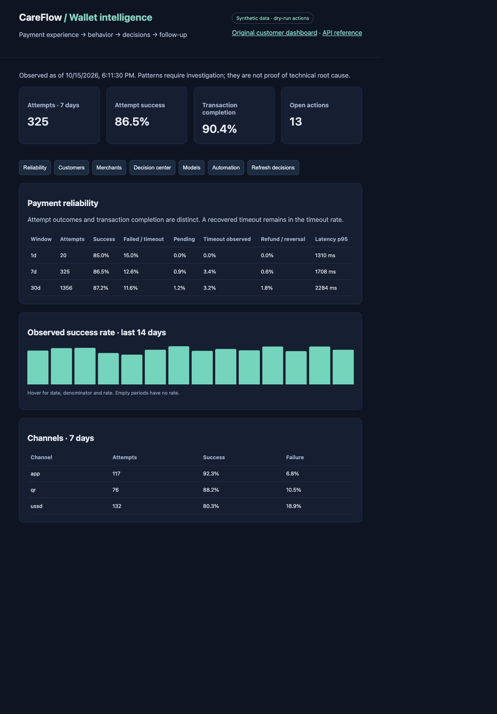
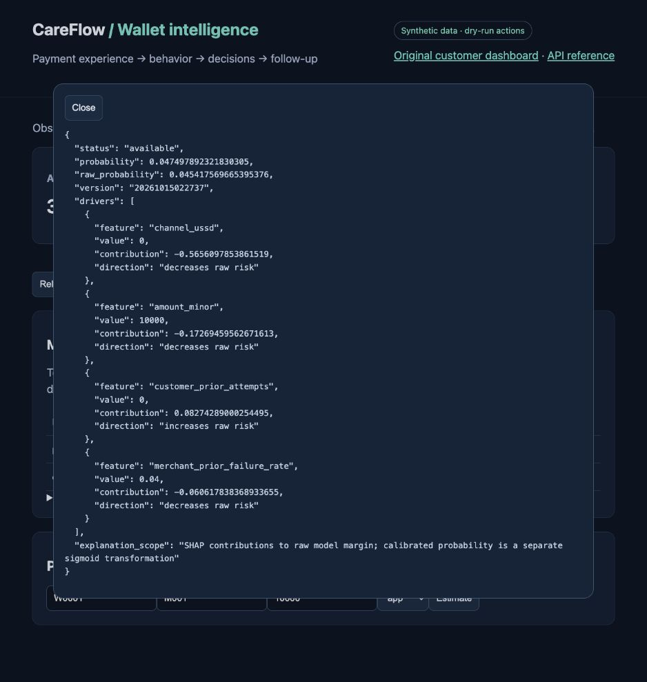

# CareFlow — Digital Wallet Experience & Retention Decision System

CareFlow connects payment reliability, customer and merchant behavior, explainable ML, and safeguarded interventions. It extends the original customer-success application: the original API, SQLite customer records, Streamlit dashboard and five n8n workflows remain available.

**Portfolio simulation:** all wallet records are synthetic. Workflow execution uses a durable **dry-run outbox**, never real customer messages. Synthetic model scores are not production performance claims.

## Run locally

Python 3.12–3.14 is recommended. Use a virtual environment.

```sh
python3 -m venv .venv
source .venv/bin/activate
pip install -r requirements-wallet.txt
python -m wallet.synthetic
python -m wallet.models
uvicorn api.main:app --host 127.0.0.1 --port 8000
```

Open http://127.0.0.1:8000/wallet for wallet intelligence; `/` retains the original dashboard and `/docs` exposes the API. The generator refuses to overwrite an existing wallet database. To create a separate reproducible demo, set `CAREFLOW_WALLET_DB` to a new filename. Local demo generation and training require no external API credentials.

```sh
python -m unittest discover -s tests -v
mlflow ui --backend-store-uri sqlite:///data/mlflow.db --port 5000
```

The wallet database is separate from `data/customers.db`; no legacy rows are replaced. The old `setup.sh` is not needed for this upgrade. See [wallet architecture, policies and methodology](docs/WALLET.md), [workflow setup](automation/wallet_workflows/README.md), and [historical README](docs/LEGACY_README.md).

## Implemented journey

1. Ingest validated customer/merchant records and immutable payment events with duplicate detection.
2. Reconcile attempts and logical transactions, including late success after timeout.
3. Calculate 24-hour/7-day/30-day reliability, RFM, overlapping customer segments, merchant baselines and insufficient-history flags.
4. Train XGBoost/LightGBM candidates with chronological splits and sigmoid calibration; record models and evaluation in MLflow.
5. Explain predictions with SHAP, clearly separating raw-model contributions from calibrated probabilities.
6. Recommend investigations, onboarding, retention, re-engagement or resolution follow-up using observed evidence, model signals and action history.
7. Approve eligible outreach and record idempotent dry-run executions with bounded retries and a seven-day contact limit.
8. Review decisions, audit history, model drift and observed post-intervention activity. No causal uplift is claimed.

## Reproducible model results

See [evaluation report](docs/model-evaluation.json) for actual test results, baselines, feature lists and time splits. These models are demonstrations, not validated financial services systems. A fixed 0.5 threshold has low recall in the current synthetic test set; operational decisions primarily use observed payment evidence and explicit rules. The 0.30 hypothetical-payment review threshold is an experimental policy, not a calibrated operational SLA.

## Configuration

| Variable | Default / responsibility |
|---|---|
| `CAREFLOW_WALLET_DB` | `data/wallet.db`, durable event, action and audit records |
| `CAREFLOW_MODEL_DIR` | `ml/wallet_models`, locally trained trusted artifacts |
| `MLFLOW_TRACKING_URI` | SQLite tracking database at `data/mlflow.db` |
| `REDIS_URL` | Optional; 30-second cache for `/wallet/summary`, never decision eligibility |
| `GROQ_API_KEY` | Original optional LLM integration; wallet outreach uses evidence-constrained templates without a required key |

Bind this demo to localhost. Authentication, operator identities, production payment integrations and external delivery are not implemented; do not expose it as a public operational service. Pickle model files must come only from your own trusted training run.

## Containers

`docker compose up --build` starts the API, Redis and n8n with loopback-only published ports. Generate/train through `docker compose exec careflow python -m wallet.synthetic` and `docker compose exec careflow python -m wallet.models`. Import the six new inactive workflow exports; keep the original workflows inactive when demonstrating wallet decisions. See the workflow README before activation.

## Screenshots




