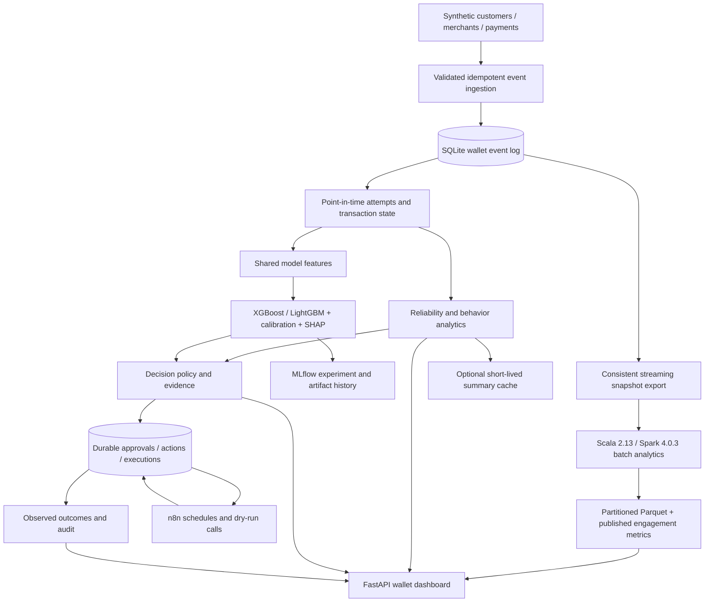

# Architecture and methodology

## Compatibility and persistence

The legacy organization customers are not silently relabeled as wallet individuals. Wallet profiles optionally retain `legacy_customer_id`; the separate wallet database prevents changes to the original dataset. Additive v1/v2 migrations create wallet tables, indexes, operator credentials and operational records. The migration runs when the wallet router loads. Data generation refuses a nonempty wallet database.

Money is an integer number of BDT minor units (paisa). Timestamps are normalized to UTC, timezone-aware and comparable; schedules use Asia/Dhaka. Customers must predate their payment events. Transaction customer, merchant, channel, currency and amount are immutable; attempt IDs cannot cross transactions. Event IDs are idempotency keys, with conflicting reuse rejected. Receipt times are assigned by the server, not by clients.

A failed/timeout/pending attempt can later succeed. Success cannot be undone by a delayed pending/failure event; only explicit refund/reversal changes the successful financial state. Reconciliation uses status precedence, then occurrence time and event ID for ties. The original events remain immutable. Refund/reversal events require an earlier successful original payment. Refund service records follow requested → approved → completed/rejected, with cumulative amounts capped at the original payment. Completed partial refunds are reported separately; a full cumulative refund writes an idempotent financial-state event in the same database transaction. This records an outcome and does not move funds. Settlements match an original successful transaction and amount; overdue due dates are operational evidence. Counts are assigned to attempt/transaction start windows and recomputed when confirmation arrives. This is a current-state view of historical cohorts, not an immutable historical report.

## Metric definitions

- Attempt success = attempts now succeeded/refunded/reversed divided by all attempts in the window.
- Failure rate = attempts now failed/timeout divided by attempts. Pending is separate.
- Transaction completion = logical transactions succeeded/refunded/reversed divided by transactions.
- Timeout rate = attempts with any observed timeout, even if later recovered.
- Retry rate = (attempt count − distinct logical transaction count) / attempt count.
- Refund/reversal rate = logical transactions currently refunded/reversed / logical transactions.
- Latency p95 uses the selected current attempt event with a non-null latency. It is not end-to-end settlement time.
- Successful monetary value and RFM exclude refunded/reversed transactions. Frequency counts successful logical transactions; active days and merchant diversity are distinct counts.
- Behavioral change compares successful activity in the last 30 days with the preceding 30. No prior activity yields an unknown percentage change.
- Unresolved issues include recent failed transactions (7 days), plus pending/timeout transactions of any age. These block outreach even when there is not enough evidence for an alert. Pending or unconfirmed timeout transactions older than 24 hours independently warrant investigation.
- Health = 50% attempt reliability + 30% frequency relative to the customer's/merchant's previous activity + 20% recency, each normalized to 0–100. No health score is produced below 10 recent attempts or 30 days of tenure. These are transparent demo weights, not learned utility or clinical/financial scores.
- Merchant deterioration requires at least 10 current and 20 baseline attempts; a success-rate drop must exceed twice the estimated sampling standard error and either 15 percentage points or 2 percentage points with at least 20 estimated excess failed attempts. It is a correlated pattern requiring investigation, not proof of infrastructure cause. Merchant size/category are displayed, and the baseline is merchant-specific; a small merchant is not penalized simply for low volume.
- High-value customers are the top 20% of observed 30-day successful value (including ties); segments overlap.

## ML

Training is an explicit command. Inference never trains or fabricates probabilities when models are missing/corrupt. Artifact files are local/trusted only.

Payment target: the first terminal outcome of an attempt is failed/timeout rather than successful. Features are amount, UTC hour, channel and seven-day prior customer/merchant failure statistics. First terminal outcomes become historical inputs only after their actual receipt, and only for attempts started in the prior seven days. A chronological availability sweep builds training features; inference uses the same cutoff definition. Delayed outcomes are neither discarded nor backdated. Current-attempt latency and outcome are not inputs. Payment training uses the first 180 days, candidate selection days 210–240, calibration days 240–270, and final test from day 300, with gaps; labels must be known before the next split begins. Pending attempts lacking a terminal outcome are excluded.

Churn target: no successful transaction in the next 30 days for a customer with at least 30 days' tenure. Snapshots at day 60/90/120/150/180 train; day 210 selects; day 240 calibrates; day 300 tests. Training labels mature before calibration begins. Feature construction filters both occurrence and receipt time to the cutoff. Customer cohorts can recur across periods; this is a prospective existing-customer evaluation, not an unseen-customer generalization claim.

XGBoost and LightGBM compete on selection-window PR-AUC. A sigmoid calibrator is fit on a separate later window. A review threshold maximizes calibration-window F1; its final-test precision and recall are reported separately. Business action thresholds remain explicit policy constants, not automatic adoption of that threshold. The final test is untouched until evaluation. Baseline predictions equal training prevalence. Reports include PR-AUC, ROC-AUC, precision/recall at 0.5 and Brier score. Both candidates and the selected artifact/version are recorded. SHAP contributions explain the raw model margin, not the transformed calibrated probability and not causation.

The decision engine also estimates a hypothetical next payment using the last merchant/channel and median historical amount. A probability ≥0.30 results in an internal risk review before marketing; the scenario and uncertainty remain in evidence. This is not a prediction about a known future transaction. Churn probability ≥0.65 can support retention, but observed unresolved issues take precedence.

MLflow uses SQLite for run metadata and local artifacts. Model JSON retains exact time boundaries and reference feature means/standard deviations. Monitoring reports standardized mean shift for churn and payment features and stores dated reports. Churn predictions logged during refresh are evaluated after their 30-day labels mature, requiring at least 20 observations and both classes. Retraining creates separate candidate directories; explicit promotion requires both test PR-AUC values to beat prevalence baselines and switches one atomic model-directory pointer. This minimal gate still requires human review; it is not evidence of production readiness. This is a drift screening statistic, not a production degradation detector. Optional Redis caches only read-only summaries for 30 seconds; unavailable Redis falls back to SQLite. Eligibility never reads cached summaries.

## Decisions and execution

Precedence: shared merchant operational incident → individual unresolved payment experience → open complaint support review → hypothetical payment risk review → onboarding → inactivity → engagement decline/high churn → no intervention. Shared merchant incidents aggregate at least three affected customers and suppress duplicate individual alerts.

Open-action uniqueness is enforced in SQLite. Refresh updates evidence and supersedes recommendations no longer supported. Recently completed identical actions have a seven-day cooldown. Customer communication requires explicit approval, stored consent, current eligibility, no unresolved customer/merchant issue, and no successful outreach in the prior seven days. Approval and overrides record the authenticated operator identity. Five roles separate read-only analysis, support, operations, automation and administration. Automation cannot approve outreach. Overrides require a reason and expire after 1–30 days.

Executions run under a SQLite immediate transaction. An execution key replays the existing result; a new key cannot execute an already completed action. Failure retries are limited to three attempts with 30/60-second backoff. This exactly-once dry-run recording does not claim exactly-once external email delivery. Execution queues a durable delivery entry. Dispatch rechecks payment evidence, consent, channel/category preferences, open complaints and experiment holdouts. Dry-run is the default. Optional SMTP over TLS and HTTPS adapters require verified allowlisted destinations. Only known pre-acceptance connection failures retry automatically; ambiguous outcomes become unknown and a process crash after claim leaves sending for reconciliation. Provider acceptance and delivered/bounced receipts are distinct. No real provider messages were sent during verification.

Resolution follow-up references an explicitly resolved incident associated with a completed individual investigation and observed successful activity; it is suppressed during unresolved issues. Outcome monitoring compares before/after successful transaction counts and marks the seven-day follow-up incomplete until matured. It cannot establish causal retention uplift, particularly when the intervention was only simulated.

## Scope and limitations

This implementation excludes fraud scoring, transaction blocking, incentive issuance and real wallet money-movement APIs. A lightweight English keyword baseline routes synthetic complaints and estimates sentiment; its confidence is a heuristic, not a calibrated NLP probability. No private provider infrastructure or real customer data is required. Original Groq modules remain optional; wallet messages are deterministic templates so eligibility and payment claims stay controlled. SMTP/HTTPS adapter code is implemented and mock-tested; real provider delivery, original Slack/Google Sheets/Groq integrations and production credentials were not exercised. The frontend reads APIs; models and n8n use the same durable records and policies.

See the checked-in evaluation report and verification report for actual results and unverified deployment details.

## Behavioral context and experiments

Synthetic generation connects failures to later engagement and includes salary-cycle, weekend, monthly-user, merchant-size and disruption patterns. Customer cadence is the median gap between successful transactions (minimum four observations); outreach inactivity requires at least max(30 days, 2.5 × cadence). A matched-weekday baseline compares the latest seven days with four preceding seven-day periods. Merchant peer context groups category and size and requires at least three peers. These are transparent baselines; they do not model holidays or prove seasonal causality. Existing health weights remain visible and sparse histories remain unscored.

Value scenarios annualize 30-day successful payment volume at an explicitly assumed 0.5% contribution margin. This is not a trained lifetime-value model or observed revenue. Complaints, delayed settlements and payment problems retain separate evidence rather than disappearing into a single score.

Experiments use deterministic hash-based customer assignment. Active control assignments suppress retention. Reports compare matured qualifying activity by arm, require at least 20 customers per arm for an approximate interval, and explicitly flag simulated outreach. Observational follow-up and simulation cannot establish real causal uplift.

## Spark execution and operational bounds

`wallet.batch` exports a consistent SQLite read snapshot with streaming writes to gzipped newline JSON and dimension files. The Scala DataFrame job filters both timestamps, reconciles attempts and transactions, aggregates reliability and engagement, and emits JSON/Parquet plus a manifest. Publishing metrics and marking success occur atomically; failures preserve logs/status. Replica runs are marked benchmark and never replace production-shaped metrics. The UI marks new-event or over-24-hour results stale. Exact metrics were compared against independent pandas calculations; Spark approximate p95 is deliberately excluded from exact equality.

The verified deployment is local[2], not a remote cluster. For cluster deployment, put exported inputs and outputs on accessible distributed storage and configure Spark resources. SQLite is the demonstration system of record, not a billion-row transactional warehouse. Gzip input is not splittable within a file; repartitioned output and distributed transformations do not make the local export infinitely scalable. API batch/retraining tasks run in-process background workers and can be interrupted by an API restart; durable job supervision is a deployment extension. Retain failed/running logs and reconcile interrupted jobs before retrying.

Operator tokens are randomly generated, hash-stored, expiring and revocable. The browser keeps its token in sessionStorage. All business APIs, including legacy routes, require authentication; docs/static/health are public. API request throttling is per process/IP. Production identity federation, multi-node rate limits, managed secrets, infrastructure hardening and financial compliance certification are outside this portfolio implementation.
