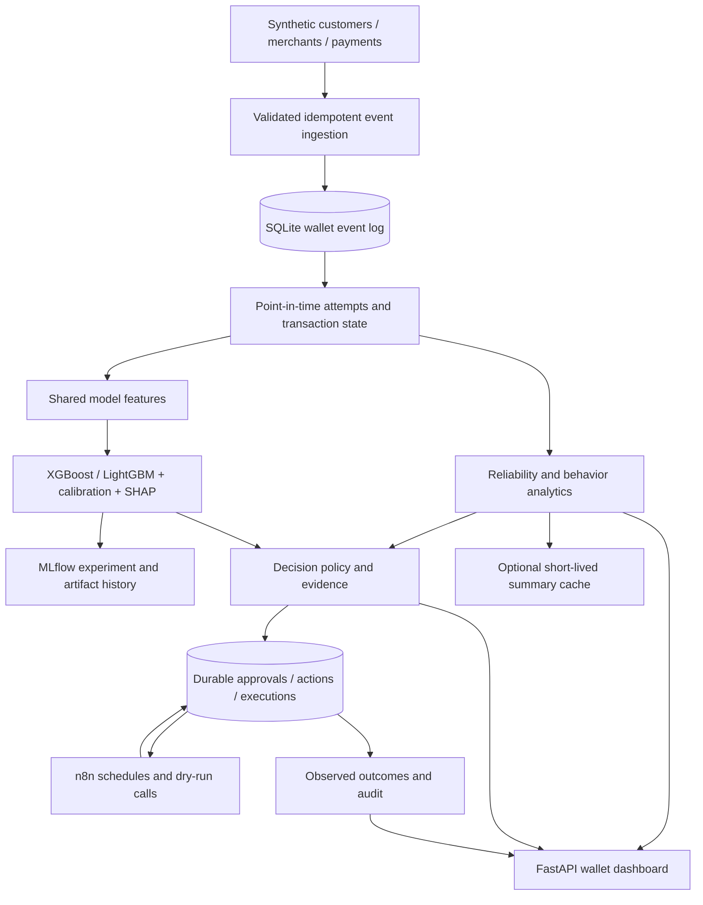

# Architecture and methodology

## Compatibility and persistence

The legacy organization customers are not silently relabeled as wallet individuals. Wallet profiles optionally retain `legacy_customer_id`; the separate wallet database prevents changes to the original dataset. The v1 additive migration creates its own tables and indexes. The migration runs when the wallet router loads. Data generation refuses a nonempty wallet database.

Money is an integer number of BDT minor units (paisa). Timestamps are normalized to UTC, timezone-aware and comparable; schedules use Asia/Dhaka. Customers must predate their payment events. Transaction customer, merchant, channel, currency and amount are immutable; attempt IDs cannot cross transactions. Event IDs are idempotency keys, with conflicting reuse rejected. Receipt times are assigned by the server, not by clients.

A failed/timeout/pending attempt can later succeed. Success cannot be undone by a delayed pending/failure event; only explicit refund/reversal changes the successful financial state. Reconciliation uses status precedence, then occurrence time and event ID for ties. The original events remain immutable. Refund/reversal is accepted as an authoritative terminal event; settlement-ledger validation is outside this simulation. Counts are assigned to attempt/transaction start windows and recomputed when confirmation arrives. This is a current-state view of historical cohorts, not an immutable historical report.

## Metric definitions

- Attempt success = attempts now succeeded/refunded/reversed divided by all attempts in the window.
- Failure rate = attempts now failed/timeout divided by attempts. Pending is separate.
- Transaction completion = logical transactions succeeded/refunded/reversed divided by transactions.
- Timeout rate = attempts with any observed timeout, even if later recovered.
- Retry rate = (attempt count − distinct logical transaction count) / attempt count.
- Refund/reversal rate = logical transactions currently refunded/reversed / logical transactions.
- Latency p95 uses the selected current attempt event with a non-null latency. It is not end-to-end settlement time.
- Successful monetary value and RFM exclude refunded/reversed transactions. Frequency counts successful logical transactions; active days and merchant diversity are distinct counts.
- Behavioral change compares successful activity in the last 30 days with the preceding 30. No prior activity yields an unknown percentage change.
- Unresolved issues include recent failed transactions (7 days), plus pending/timeout transactions of any age. These block outreach even when there is not enough evidence for an alert. Pending or unconfirmed timeout transactions older than 24 hours independently warrant investigation.
- Health = 50% attempt reliability + 30% frequency relative to the customer's/merchant's previous activity + 20% recency, each normalized to 0–100. No health score is produced below 10 recent attempts or 30 days of tenure. These are transparent demo weights, not learned utility or clinical/financial scores.
- Merchant deterioration requires at least 10 current and 20 baseline attempts; a success-rate drop must exceed both 15 percentage points and twice the estimated sampling standard error. It is a correlated pattern requiring investigation, not proof of infrastructure cause. Merchant size/category are displayed, and the baseline is merchant-specific; a small merchant is not penalized simply for low volume.
- High-value customers are the top 20% of observed 30-day successful value (including ties); segments overlap.

## ML

Training is an explicit command. Inference never trains or fabricates probabilities when models are missing/corrupt. Artifact files are local/trusted only.

Payment target: the first terminal outcome of an attempt is failed/timeout rather than successful. Features are amount, UTC hour, channel and seven-day prior customer/merchant failure statistics. Only first-event terminal outcomes received immediately enter this deliberately conservative historical feature set; delayed outcomes are excluded rather than backdated. Current-attempt latency and outcome are not inputs. Payment training uses the first 210 days, calibration days 240–270, and final test from day 300, with gaps. Pending attempts lacking a terminal outcome are excluded.

Churn target: no successful transaction in the next 30 days for a customer with at least 30 days' tenure. Snapshots at day 60/90/120/150/180 train; day 240 calibrates/selects; day 300 tests. Training labels mature before calibration begins. Feature construction filters both occurrence and receipt time to the cutoff. Customer cohorts can recur across periods; this is a prospective existing-customer evaluation, not an unseen-customer generalization claim.

XGBoost and LightGBM compete on calibration-window PR-AUC. A sigmoid calibrator is fit on that same middle window; selection and calibration share data, a documented limitation. The final test is untouched until evaluation. Baseline predictions equal training prevalence. Reports include PR-AUC, ROC-AUC, precision/recall at 0.5 and Brier score. Both candidates and the selected artifact/version are recorded. SHAP contributions explain the raw model margin, not the transformed calibrated probability and not causation.

The decision engine also estimates a hypothetical next payment using the last merchant/channel and median historical amount. A probability ≥0.30 results in an internal risk review before marketing; the scenario and uncertainty remain in evidence. This is not a prediction about a known future transaction. Churn probability ≥0.65 can support retention, but observed unresolved issues take precedence.

MLflow uses SQLite for run metadata and local artifacts. Model JSON retains exact time boundaries and reference feature means/standard deviations. Monitoring reports standardized mean shift for current churn features. This is a drift screening statistic, not a production degradation detector. Optional Redis caches only read-only summaries for 30 seconds; unavailable Redis falls back to SQLite. Eligibility never reads cached summaries.

## Decisions and execution

Precedence: shared merchant operational incident → individual unresolved payment experience → hypothetical payment risk review → onboarding → inactivity → engagement decline/high churn → no intervention. Shared merchant incidents aggregate at least three affected customers and suppress duplicate individual alerts.

Open-action uniqueness is enforced in SQLite. Refresh updates evidence and supersedes recommendations no longer supported. Recently completed identical actions have a seven-day cooldown. Customer communication requires explicit approval, stored consent, current eligibility, no unresolved customer/merchant issue, and no successful outreach in the prior seven days. Approval is local-demo state, not an authenticated production operator signature.

Executions run under a SQLite immediate transaction. An execution key replays the existing result; a new key cannot execute an already completed action. Failure retries are limited to three attempts with 30/60-second backoff. This exactly-once dry-run recording does not claim exactly-once external email delivery. No external send adapter is enabled.

Resolution follow-up references a completed individual investigation and observed successful activity; it is suppressed during unresolved issues. Outcome monitoring compares before/after successful transaction counts and marks the seven-day follow-up incomplete until matured. It cannot establish causal retention uplift, particularly when the intervention was only simulated.

## Scope and limitations

This implementation deliberately excludes fraud scoring, transaction blocking, incentives, real wallet APIs and complaint NLP. No private provider infrastructure or real customer data is required. Original Groq modules remain optional; wallet messages are deterministic templates so eligibility and payment claims stay controlled. Live SMTP, Slack and CRM delivery are not claimed. The frontend reads APIs; models and n8n use the same durable records and policies.

See the checked-in evaluation report and verification report for actual results and unverified deployment details.
